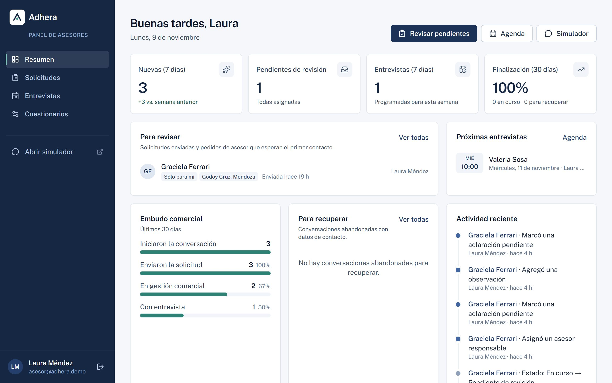
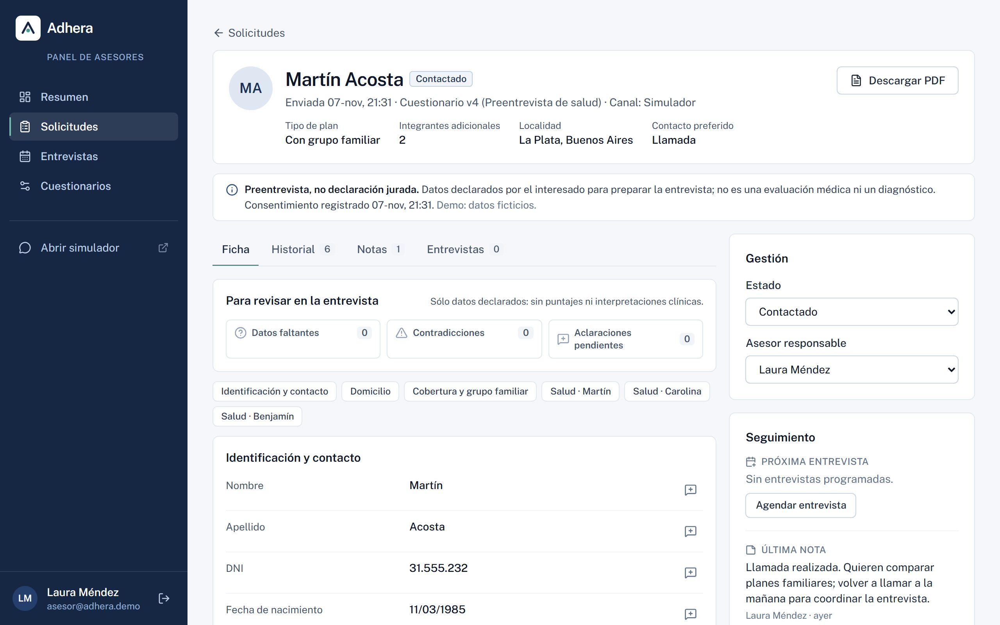
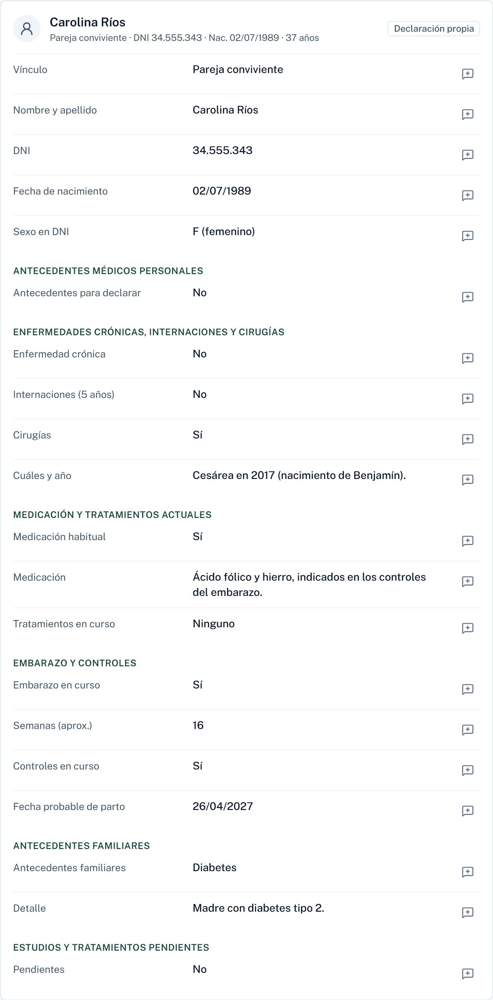

# Adhera

**Preentrevistas de afiliación conversacionales** — el interesado responde un cuestionario estilo WhatsApp; el asesor recibe una ficha lista para revisar, asignar y continuar el proceso comercial.

> Demo / MVP con **datos 100 % ficticios**. No es un entorno de producción ni una declaración jurada de salud.

<p align="center">
  
</p>

<p align="center">
  
  
  
  
  
  
</p>

---

## ¿Qué resuelve?

Los asesores suelen repetir las mismas preguntas antes de la entrevista. Adhera **recopila respuestas por conversación** (simulador web o WhatsApp Cloud API), valida y ramifica el cuestionario, y entrega una **ficha profesional** con resumen, historial, notas y agenda de entrevistas.

| Para el interesado | Para el asesor |
|---|---|
| Chat tipo mensajería, con progreso y reanudación por enlace | Dashboard con KPIs y cola “para revisar” |
| Validaciones en vivo (números, fechas, opciones, etc.) | Solicitudes segmentadas: enviadas / en curso / abandonadas |
| Preentrevista de salud por integrante (cuestionario v2) | Ficha, PDF A4, asignación, notas y entrevistas |

---

## Características

- **Motor conversacional** con preguntas tipadas (`text`, `number`, `yes_no`, `single_choice`, `date`), condiciones y versionado inmutable del cuestionario
- **Simulador web** (`/simulador`, `/demo`) y canal **WhatsApp Cloud API** sobre el mismo motor
- **Panel comercial**: resumen, solicitudes, ficha, entrevistas y editor de cuestionarios
- **Preentrevista de salud (v2)** por secciones e integrantes, con ficha y exportación PDF
- **Sesiones** con cookie HttpOnly, seed demo y tests unitarios + E2E (Playwright)
- **Despliegue** pensado para Render + Neon (`render.yaml`)

---

## Stack

| Capa | Tecnología |
|---|---|
| Frontend | **Next.js 15**, React 19, Tailwind CSS 4, TanStack Query, UI estilo shadcn |
| Backend | **NestJS 11**, Zod, sesiones por cookie, rate limiting |
| Datos | **PostgreSQL 16**, **Prisma 6** |
| Canales | Simulador web · WhatsApp Cloud API (Meta) |
| Calidad | TypeScript, ESLint, Vitest, Playwright |
| Infra | Docker Compose (local), Render + Neon (público), pnpm workspaces |

```
apps/
  api/     NestJS + Prisma (API, motor, WhatsApp, PDF)
  web/     Next.js (landing, simulador, panel del asesor)
docs/      PRD, RFC, API, despliegue, WhatsApp, privacidad
e2e/       Pruebas end-to-end
```

---

## Capturas

<p align="center">
  
  &nbsp;
  
</p>

---

## Inicio rápido

**Requisitos:** Node 20.12+ · pnpm 10+ · Docker Desktop

```bash
pnpm install
cp .env.example apps/api/.env   # generá un SESSION_SECRET propio
pnpm db:up                      # PostgreSQL en localhost:5433
pnpm db:deploy                  # migraciones
pnpm db:seed                    # asesores + cuestionario + casos ficticios
pnpm dev                        # API :4000 · web :3000
```

| URL | Uso |
|---|---|
| http://localhost:3000 | Landing / panel (según sesión) |
| http://localhost:3000/simulador | Conversación de preafiliación |
| http://localhost:3000/demo | Demo pública sin login |
| http://localhost:3000/login | Acceso de asesor |

**Credenciales de demo (ficticias):** `asesor@adhera.demo` / `adhera-demo`  
También: `martin@adhera.demo` y `sofia@adhera.demo`. No usar en producción.

### Verificaciones

```bash
pnpm lint && pnpm typecheck && pnpm test && pnpm build
npx playwright install chromium   # una sola vez
pnpm test:e2e                     # base adhera_test aislada (Docker)
```

---

## Guion de demo (~5 min)

1. Abrí `/simulador`, aceptá el aviso y completá el cuestionario (probá validaciones, p. ej. cantidad de integrantes).
2. Refrescá: la conversación continúa. El ícono de enlace copia un link para retomar en otro navegador.
3. Enviá la solicitud e ingresá como asesor: aparece en `/solicitudes` y actualiza el resumen.
4. Abrí la ficha: resumen, respuestas, historial; asigná asesor, nota y entrevista.
5. En `/cuestionarios` editá un borrador y publicá: las sesiones nuevas usan la versión nueva.

---

## Documentación

| Documento | Contenido |
|---|---|
| [docs/PRD.md](docs/PRD.md) | Producto, alcance y criterios de aceptación |
| [docs/RFC.md](docs/RFC.md) | Arquitectura, seguridad y decisiones |
| [docs/DATA_API.md](docs/DATA_API.md) | Esquema y contrato HTTP |
| [docs/PREENTREVISTA.md](docs/PREENTREVISTA.md) | Cuestionario de salud v2 |
| [docs/WHATSAPP.md](docs/WHATSAPP.md) | Integración WhatsApp Cloud API |
| [docs/DEPLOY.md](docs/DEPLOY.md) | Despliegue Render + Neon |
| [docs/PRIVACIDAD.md](docs/PRIVACIDAD.md) | Datos sensibles y retención |
| [docs/DESIGN.md](docs/DESIGN.md) | Criterios de diseño de UI |

---

## Scripts útiles

| Comando | Descripción |
|---|---|
| `pnpm dev` | API + web en paralelo |
| `pnpm db:up` / `db:deploy` / `db:seed` | Base local, migraciones y seed |
| `pnpm db:reset` | Base limpia + seed (borra datos) |
| `pnpm test` | Tests unitarios (API) |
| `pnpm test:e2e` | Playwright (entorno aislado) |

---

## Aviso

Este repositorio es una **demostración técnica**. Los datos del seed, las credenciales y las conversaciones son ficticios. No debe usarse para afiliaciones reales ni para almacenar información sensible de personas reales sin una revisión de seguridad, privacidad y cumplimiento propia.
